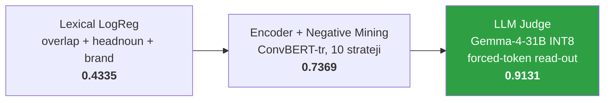
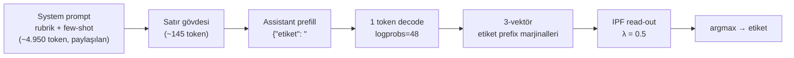
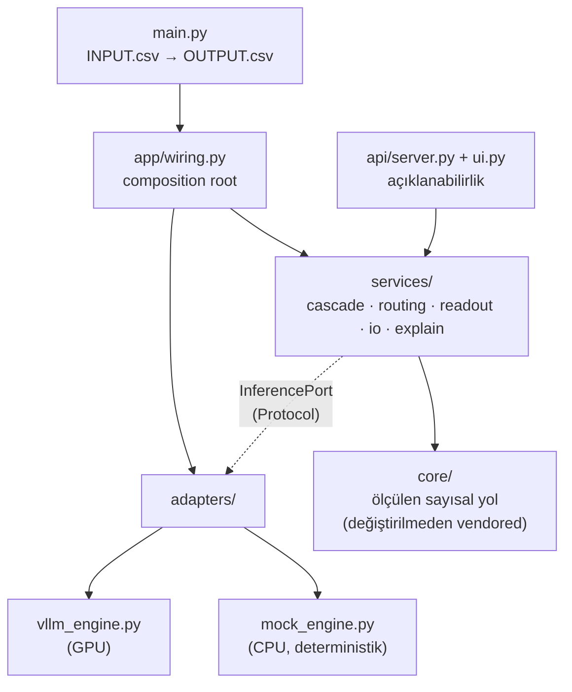

<div align="center">

# DreamTeam — Türkçe E-Ticaret Aramasında Üç Sınıflı Relevance

**Gold irrelevant verisi olmadan, tek GPU üzerinde LLM judge ile sorgu/ürün alaka sınıflandırması**

*Trendyol E-Ticaret Yarışması 2026 · Stage 2*

<p>
  
  
  
</p>
<p>
  
  
  
  
  
  
</p>

[Problem](#-problem) · [Yaklaşım](#-yaklaşım) · [Sonuçlar](#-sonuçlar) · [Mimari](#️-mimari) · [Kurulum](#-kurulum-ve-çalıştırma) · [Açıklanabilirlik](#-açıklanabilirlik) · [Teknik Rapor](DreamTeam_Stage2_Teknik_Rapor.pdf)

</div>

---

## 📌 Özet

Her `(query, product)` çifti için ürünün sorguya **relevant**, **semi-relevant** ya da **irrelevant**
olduğunu tahmin eden bir sistem. Organizatörün 500.000 satırlık eğitim setinde **tek bir irrelevant
örnek yok**. Bu yüzden klasik sınıflandırıcılar üçüncü sınıfı göremiyor.

Çözümümüz `Gemma-4-31B-it-INT8` modelini **metin üretmeyen** bir LLM judge olarak kullanıyor. Model
sadece prefill aşamasında çalışıyor ve **tek bir token**'ın logprob'larından üç sınıflı olasılık
vektörü okunuyor.

| | |
| --- | --- |
| 🎯 **macro-F1** | **0.9131** (90.000 satır, query-disjoint) |
| ⏱️ **Süre** | **46.9 dk** (limit 150 dk) · ~33 satır/sn |
| 🖥️ **Donanım** | Tek NVIDIA A100-SXM4-40GB |
| 📉 **Lexical baseline** | 0.4335 (oracle eşiklerle bile) |
| 🔒 **Ortam** | read-only rootfs · network yok · rastgele UID |

---

## 🧩 Problem

Gerçek irrelevant örnekleri **rastgele alakasız ürünler değil**. Sorguyla aynı üst kategoriden geliyor,
sözcük olarak çok yakın duruyor ama **kilit bir niteliği ihlal ediyor**:

| sorgu | ürün | etiket |
| --- | --- | --- |
| yeşil topuklu ayakkabı | yeşil sneaker | ❌ irrelevant |
| penti plaj çantası | bikini altı | ❌ irrelevant |
| bershka şort | geniş yaka top | ❌ irrelevant |
| beyaz şık elbise | çiçek desenli balon kol elbise | ❌ irrelevant |

Rastgele ya da kategori dışı negatiflerle eğitilen bir model bu örnekleri semi-relevant sanıyor.

**Veri seti:**

| dosya | satır | not |
| --- | ---: | --- |
| `train` | 500.000 | 250k relevant + 250k semi-relevant, **0 irrelevant** |
| `public_test` | 7.500 | her sınıftan 2.500 |
| `private_test` | 90.000 | 30k / 30k / 30k, dengeli |
| `items.csv` | 962.873 ürün | test başlıklarının yalnızca ~%16'sını kapsıyor |

Train, public ve private setlerindeki sorgular birbirleriyle **kesişmiyor** (query-disjoint).

---

## 🚀 Yaklaşım

### Gelişim süreci



1. **Lexical baseline (0.4335):** Overlap, head-noun ve marka özellikleriyle logistic regression.
   Sınıf bazında F1: relevant 0.481, semi 0.399, irrelevant 0.387. Relevant/semi ekseni irrelevant
   sınıfını ayıramıyor, ayrı bir sinyal gerekiyor.
2. **Encoder + negative mining (0.7369):** `dbmdz/convbert-base-turkish-cased` ile 10 farklı
   irrelevant üretme stratejisi denendi (random-crosscat, sibling-leaf, BM25 near-miss, dense
   hard-neg, **attr-contradiction**, Stage-1 PU mining, LLM distill, query-swap, ordinal self-train,
   hybrid curriculum). En isabetlisi, gerçek irrelevant semantiğini taklit eden **A5
   attr-contradiction** oldu. Encoder kapasitesi burada tıkandı.
3. **LLM judge (0.9131):** Fine-tune yapılmadı. Hazır instruction-tuned model, rubrik ve sabit bir
   few-shot bloğuyla yönlendirildi.

### Forced-token read-out



- Assistant yanıtı `{"etiket": "` ile önceden doldurulur ve `max_tokens=1` ile **tam bir token**
  çözülür.
- Her etiketi tek başına prefix'leyen vocabulary token'larının olasılıkları toplanarak 3-vektör
  elde edilir.
- **Hiçbir şey generate edilmez.** Parse edilecek JSON yok, bozuk çıktı riski yok.
- Ölçülen `label_mass_mean` tüm koşumlarda **0.998–1.000**. Bu, okuma pozisyonunun doğru olduğunu
  gösteren bir değişmez olarak kullanıldı.
- Few-shot bloğu `train.parquet`'ten **seed 4** ile deterministik çekildi (8.710 karakter) ve
  SHA'sıyla birlikte `src/assets/shots_gfs4.txt` olarak paketlendi. Asset eksik ya da farklıysa
  sistem **durur**, sessizce farklı bir model gibi davranmaz.

### Neden INT8?

A100 (SM80) mimarisinde **INT8 W8A8 tensor core'larda native** çalışıyor. FP8 tensor core'u yok. FP8
checkpoint'ler Marlin W8A16'ya düşürülüyor ve yavaşlıyor. Bu yüzden FP8 MoE gate'li cascade de
beklenen hızı vermedi.

---

## 📊 Sonuçlar

### Sınıf bazında (90.000 satır)

| sınıf | F1 |
| --- | ---: |
| relevant | 0.9370 |
| irrelevant | 0.9287 |
| semi-relevant | 0.8737 |
| **macro** | **0.9131** |

Semi-relevant hem relevant hem irrelevant ile sınır komşusu olduğu için en zor sınıf.

### Validasyon

| set | macro-F1 | paired-bootstrap SE |
| --- | ---: | ---: |
| public holdout (7.000) | 0.9172 | 0.0060 |
| bağımsız değerlendirme (90.000) | **0.9131** | ~0.0017 |

İki set arasındaki −0.004'lük fark küçük sete aşırı uyum olmadığını gösteriyor.

### Cascade mi, tek model mi?

Geliştirmede ucuz bir MoE gate (`gemma-4-26B-A4B-FP8`) ile sadece belirsiz satırları 31B modele
gönderen bir cascade da kuruldu:

| konfigürasyon | macro-F1 | süre |
| --- | ---: | ---: |
| cascade @ %5 | 0.8741 | 24.8 dk |
| cascade @ %10 | 0.8798 | 28.6 dk |
| cascade @ %15 | 0.8903 | 29.4 dk |
| cascade @ %20 | ≤ 0.8935 | 32.8 dk |
| **champion-only ✅** | **0.9131** | **46.9 dk** |

Cascade her oranda daha hızlı ama daha kötü. Gate her oranda 90.000 satırın tamamını puanlamak
zorunda olduğu için toplam sürenin %62–80'ini tek başına harcıyor. Ayrıca iki koşum arasında %4.43
label flip ile replicate kararsızlığı taşıyor. 150 dakikalık limitte kazanılan 17.5 dakika 0.023
macro-F1 kaybına değmediği için **teslim edilen imajda sadece champion var**.

### Read-out ablation

| yöntem | macro-F1 |
| --- | ---: |
| argmax | 0.8840 |
| IPF λ=0.25 | 0.8874 |
| **IPF λ=0.50** | **0.8879** |
| IPF λ=0.75 | 0.8860 |
| IPF λ=1.00 | 0.8814 |
| hard pin | 0.8812 |

Dağılımı bilinen 30k/30k/30k oranına tam oturtmak, yarı yolda bırakmaktan daha kötü sonuç veriyor.

### Tokenizasyon hızlandırması

| yöntem | süre (90k satıra ölçekli) |
| --- | ---: |
| serial loop | 567.5 sn |
| batch + `TOKENIZERS_PARALLELISM=false` | 401.4 sn |
| batch + parallel | 16.5 sn |
| **prefix splice + batch + parallel** | **7.0 sn** (81× hızlı) |

Gerçek koşumda süre 588 sn'den **27 sn**'ye indi ve **90.000/90.000 satır bit-identical** çıktı.
`encode_spliced` bir örneği orijinal yoldan tekrar encode edip karşılaştırıyor ve uyuşmazlık
görürse yavaş ama doğru yola geri dönüyor.

### Süre dağılımı (toplam 2.812,8 sn)

| aşama | süre | pay |
| --- | ---: | ---: |
| engine boot | 45.1 sn | %1.6 |
| tokenizasyon | 27.0 sn | %1.0 |
| **generate** | **2.732,3 sn** | **%97.1** |
| teardown | 8.4 sn | %0.3 |

---

## 🏗️ Mimari

Ports & adapters. Her yetenek, tanımlı bir arayüzün arkasında bağımsız test edilebilen bir servis.
Her iki tarafı da bilen tek yer composition root.



- `services/` hiçbir zaman `adapters/` import etmez. Bu sayede tüm orkestrasyon GPU olmadan
  laptopta çalışır.
- `core/` bilerek refactor edilmedi: raporlanan her sayı bu kod üzerinden ölçüldü. Kodu yeniden
  yazmak, ölçülen ve teslim edilen sayıları iki farklı yola ayırırdı.

```
.
├── DreamTeam_Stage2_Teknik_Rapor.pdf   # 11 sayfalık teknik rapor
└── DreamTeam_docker/
    ├── Dockerfile                      # CUDA 13 devel + vLLM + FlashInfer + ngrok
    ├── build_docker.sh                 # derleme + imaj içi smoke test
    ├── fetch_models.sh                 # ağırlıkları indirir (~32 GB, HF_TOKEN gerekir)
    ├── run_solution.sh                 # tahmin modu (organizatör scripti)
    ├── run_explainability.sh           # açıklanabilirlik UI + ngrok (organizatör scripti)
    ├── entrypoint.sh
    ├── smoke_test.sh                   # mock engine ile uçtan uca
    ├── requirements.txt
    ├── src/
    │   ├── main.py                     # giriş noktası
    │   ├── app/                        # config · contracts · errors · wiring
    │   ├── services/                   # cascade · routing · readout · io · explain
    │   ├── adapters/                   # vllm_engine · mock_engine
    │   ├── api/                        # FastAPI server + tek dosyalık UI
    │   ├── core/                       # prompt, read-out, IPF, engine profilleri
    │   └── assets/shots_gfs4.txt       # sabit few-shot bloğu
    └── tests/test_cascade.py
```

---

## ⚡ Kurulum ve Çalıştırma

### Gereksinimler

- NVIDIA GPU (hedef: A100-SXM4-40GB), driver ≥ 580
- Docker + NVIDIA Container Toolkit
- ~70 GB disk (ağırlıklar + imaj)
- Model indirmek için Hugging Face token'ı

### Adımlar

```bash
cd DreamTeam_docker

# 1) Model ağırlıklarını build context'e indir (bir kez, ~32 GB)
HF_TOKEN="hf_..." ./fetch_models.sh

# 2) İmajı derle (ağırlıklar eksikse otomatik indirir)
CONTAINER_NAME="DreamTeam_solution" ./build_docker.sh

# 3) Tahmin üret
CONTAINER_NAME="DreamTeam_solution" \
  ./run_solution.sh /abs/path/input.csv /abs/path/submission.csv

# 4) Açıklanabilirlik arayüzünü başlat
NGROK_AUTHTOKEN="..." CONTAINER_NAME="DreamTeam_solution" \
  ./run_explainability.sh /abs/path/public_test.csv
```

### Girdi / çıktı sözleşmesi

```text
input:  row_id,query,title,category,brand,gender,age_group,attributes
output: row_id,real_label
```

| exit code | anlamı |
| :---: | --- |
| `0` | doğrulanmış çıktının tamamı diskte |
| `1` | üretim sırasında hata |
| `2` | hatalı çağrı ya da girdi |

Hata durumunda **makul görünen yanlış bir CSV üretilmez**. Exit 0 veren yanlış bir submission,
nonzero dönen bir koşumdan daha tehlikelidir.

### GPU olmadan test

```bash
cd DreamTeam_docker
python3 -m pytest tests/ -q   # ~0.5 sn, mock engine
./smoke_test.sh               # main.py uçtan uca
```

Testler sessizce bozulan durumları kapsıyor: yanlış satıra düşen tahminler, hata sonrası açık kalan
engine'ler, `007`'nin `7`'ye dönmesi, tırnaklı çok satırlı alanlar, yarım kalan çıktı ve
deterministik olmayan routing.

---

## 🔍 Açıklanabilirlik

`run_explainability.sh` aynı konteynerde bir FastAPI arayüzü ve ngrok tüneli açar. Ayrı bir
"açıklayıcı model" yok, tahmin yapan modelin kendisi açıklıyor:

1. **Posterior:** Sonradan hesaplanmış bir güven skoru değil, argmax'ın alındığı 3-vektörün
   kendisi.
2. **Occlusion attribution:** Her alan sırayla boşaltılıp satır aynı yoldan yeniden puanlanır.
   Log-posterior farkı o alanın katkısıdır. Tek-feature coalition'lı, Shapley tarzı ve deploy
   edilen model üzerinde birebir hesaplanan bir atıf. Alan başına maliyeti tek bir prefill.
3. **Routing marjı:** En yüksek iki log-olasılık arasındaki fark.
4. **IPF şeffaflığı:** IPF global bir işlem olduğu için satır bazında uydurulmaz. Ham posterior
   gösterilir ve bu durum arayüzde açıkça belirtilir.

**Akış:** `row_id` seç → ürün alanları gelir → sorguyu istersen düzenle → **Explain**.

`/health` engine tamamen ayağa kalkana kadar fail-closed çalışır, yani tünel ölü bir modelin önünde
açılmaz. Sayfa tek dosyadır, CDN ya da harici font kullanmaz.

---

## 🛡️ Kısıtlı Ortamda Çalışma

`run_solution.sh` konteyneri `--read-only`, `--network none`, `--cap-drop ALL`, rastgele host UID ve
8 GB `/tmp` tmpfs ile çalıştırır. Bu ayarların her biri naif bir imajı bozar:

| kısıt | çözüm |
| --- | --- |
| read-only rootfs | vLLM, Triton, torch inductor, HF ve FlashInfer cache'leri `ENV` ile `/tmp`'ye yönlendirildi |
| hesabı olmayan UID | `entrypoint.sh` Python'dan önce `$HOME`'u oluşturur (`expanduser` import'ta çökmesin) |
| network yok | `HF_HUB_OFFLINE`, `TRANSFORMERS_OFFLINE`, `VLLM_NO_USAGE_STATS`… ağırlıklar imajda gömülü |
| swap yok (70 GB sert limit) | tepe RAM kullanımı limitin çok altında, ağırlıklı olarak reclaimable page cache |
| tek çıktı dosyası | run manifest `/tmp`'ye yazılır, çıktı dizinine yalnızca submission gider |

Build secret kullanılmıyor. Ağırlıklar `docker build`'den önce context'e alındığı için hiçbir
katmana token sızmıyor. `build_docker.sh` kurallara uygun olarak global Docker temizliği **yapmaz**.

<details>
<summary><b>Serving konfigürasyonu</b></summary>

| öğe | değer | gerekçe |
| --- | --- | --- |
| base imaj | `nvidia/cuda:13.0.0-devel-ubuntu24.04` | Triton JIT için ptxas/nvcc gerekli |
| `max_model_len` | 5250 | public_test'teki en uzun prompt 5.178 token |
| `gpu_memory_utilization` | 0.94 | 0.97'de FlashInfer workspace sampler'a yer bırakmıyor, warm-up OOM |
| attention | FlashInfer | canlı probe ile `FlashInferImpl` doğrulandı |
| batching | `max_num_seqs=256`, `max_num_batched_tokens=4096` | |
| prefix caching | açık | ~4.950 token'lık ortak prefix |
| `enforce_eager` | `True` | saf prefill iş yükünde eager %0.4 daha hızlı |
| decoding | greedy, `temperature=0`, `max_tokens=1`, `logprobs=48`, `seed=0` | |
| KV havuzu | 2.194 blok × 16 = 35.104 token | en uzun prompt'a göre 7.08× pay |

> vLLM log'undaki `GPU KV cache size` satırı bu modelin heterojen attention katmanlarında
> (50 sliding-window + 10 full) değeri **~5.5× düşük** gösteriyor. Yukarıdaki KV değerleri canlı
> probe ile ölçüldü.

</details>

<details>
<summary><b>İşe yaramayanlar</b></summary>

- **Cascade (gate + champion):** daha hızlı ama her oranda daha kötü (yukarıya bakın).
- **Dağılımı sabitleme (hard pin):** IPF λ=0.5'ten 0.0067 daha kötü.
- **Gate'e FlashInfer zorlamak:** 1.56× yavaşlattı (1.895 sn ve 1.218 sn).
- **Tokenizasyon disk cache'i:** diskten okuma 3.92 sn, sıfırdan hesaplama 1.55 sn.
- **Kural tabanlı ön eleme (10 agent'lık tur):** sıfır kural ship edildi. Router skoru ile gate
  güveni arasındaki korelasyon −0.845. Ucuz kuralların yakaladığı yüksek-precision satırları router
  zaten eliyordu. 724 conjunction'ın hiçbiri 0.90 precision'ı geçemedi.
- **Prompt'u kısaltmak:** body token'ı prefix token'ından 49× pahalı. Prompt'u yarıya indirmek
  süreyi sadece %17 azaltıyor.

</details>

<details>
<summary><b>Bilinen sınırlamalar</b></summary>

- Öğrenilmiş router (AUC 0.8892, margin router'da 0.8184) imajda yok. Kullandığı encoder
  checkpoint'leri kaydedilmediği için private satırlarda değerlendirilemiyor. Teslim edilen
  champion-only konfigürasyonu routing kullanmadığı için bundan etkilenmiyor.
- MoE gate batch-nondeterministic. Bu durum sadece cascade açılırsa önemli.
- `DT_FRAC=0.15` cascade'i seçer. Gate checkpoint'i olmadığında `wiring` açık bir hata verir ve
  network kapalı bir ortamda indirme denemez.

</details>

---

## 🧪 Geliştirme Ortamı

- **Sunucular:** vast.ai üzerinde A100-SXM4-40GB (ana), ayrıca RTX 4090, RTX PRO 6000, H100
- **Yazılım:** vLLM 0.28.0 · torch 2.13.0+cu130 · flashinfer-python 0.6.16.post3 · CUDA 13.0
- **Host driver:** 580.126.20
- Nihai ölçümlerin tamamı, organizatörün hedef kartıyla aynı olan tek bir A100-SXM4-40GB üzerinde
  yapıldı.

---

## 📚 Dokümantasyon

- 📄 **[Teknik Rapor (PDF)](DreamTeam_Stage2_Teknik_Rapor.pdf)**: problem, EDA, negative
  sampling, model seçimi, ablation'lar ve nihai yapılandırma
- 🔧 **[DreamTeam_docker/README.md](DreamTeam_docker/README.md)**: imaj, ölçümler ve
  tekrarlanabilirlik kaydı (İngilizce)

## 📜 Lisans ve Kullanılan Varlıklar

| varlık | kaynak | lisans |
| --- | --- | --- |
| `lokeshe09/gemma-4-31B-it-INT8` | Hugging Face | [Gemma Terms of Use](https://ai.google.dev/gemma/terms) |
| `RedHatAI/gemma-4-26B-A4B-it-FP8-dynamic` | Hugging Face | Gemma Terms of Use (sadece geliştirmede, imajda yok) |
| `dbmdz/convbert-base-turkish-cased` | Hugging Face | MIT (sadece encoder deneylerinde) |
| Yarışma verisi | organizatör | yarışma koşulları, **bu repoda yer almaz** |

<div align="center">

**DreamTeam** · Trendyol E-Ticaret Yarışması 2026

</div>
